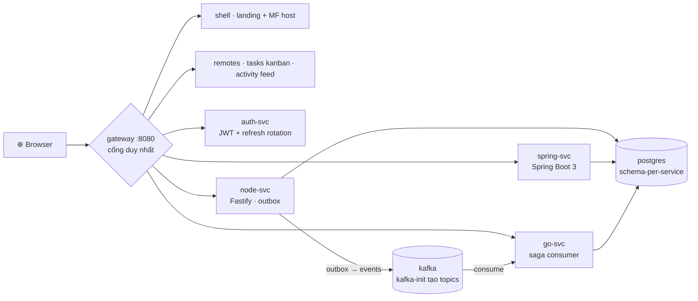

<div align="center">


# wakii

### Design system 90+ components · full-stack platform · một lệnh

Mọi thứ bạn thấy trong ảnh trên là **sản phẩm thật của repo này** — chạy bằng
`docker compose up`, không mock, không screenshot từ dự án khác.

**90+** components · **1328** tests · **3** npm packages · **10** services

[](https://www.npmjs.com/package/@wakii/ui-kit)
[](https://www.npmjs.com/package/create-wakii-app)
[](https://www.npmjs.com/package/create-wakii-stack)
[](https://storybook-static-khaki-two.vercel.app)
[](LICENSE)

</div>

---

## Sản phẩm thật, không lời hứa

| Kanban — kéo card đổi status | Activity — Kafka realtime |
|:---:|:---:|
|  |  |

Tạo một task ở Kanban → event đi qua **Kafka** → xuất hiện ngay ở Activity feed.
Gắn task cho user `fail@demo.local` → saga rollback → event vào **DLQ**. Tất cả
được kiểm chứng bởi [`scripts/smoke/e2e.sh`](scripts/smoke/e2e.sh) chạy trong CI.

## Bắt đầu trong 30 giây

```bash
# ① chỉ FE — React starter dogfood ui-kit
npm create wakii-app@latest my-app

# ② cả nền tảng — FE + 3 backend + gateway + postgres + kafka
npm create wakii-stack@latest my-stack
cd my-stack && cp platform/.env.example platform/.env
docker compose --env-file platform/.env up -d      # → http://localhost:8080

# ③ design system một mình
pnpm add @wakii/ui-kit        # 90+ components, dark/light, motion, a11y
```

> Đăng nhập demo: `alice@demo.local / demo-password` · Storybook:
> [storybook-static-khaki-two.vercel.app](https://storybook-static-khaki-two.vercel.app)

## Ba packages, một hệ sinh thái

| | Package | Là gì |
|---|---|---|
| 🎨 | **[@wakii/ui-kit](https://www.npmjs.com/package/@wakii/ui-kit)** | 90+ React components (antd × PrimeReact parity) — tokens-first, Tailwind v4, `UiKitProvider` theming, peer-deps optional sau subpath (`/carousel` `/chart` `/editor` `/schedule` `/experience3d`) |
| ⚡ | **[create-wakii-app](https://www.npmjs.com/package/create-wakii-app)** | CRA-style starter — TS/JS, router v7, extras demo, dark toggle chạy thật |
| 🏗️ | **[create-wakii-stack](https://www.npmjs.com/package/create-wakii-stack)** | Full-architecture starter — chọn services qua manifest, prune compose/lock/workspace đúng selection, `kafka-init` chống race topic |

## Bên dưới là gì



| Tầng | Thành phần |
|---|---|
| **Experience** | shell (landing 3D + nav) · remotes (kanban drag · feed realtime) · admin showcase |
| **Edge** | nginx gateway — routing · JWT presence · `/remotes/*` registry |
| **Services** | node-svc :3001 · spring-svc :8081 · go-svc :8082 · auth-svc :8090 |
| **Infra** | postgres :5432 (schema-per-svc) · kafka :9092 (KRaft + kafka-init) |

## Repo map

```
contracts/    source of truth — openapi (spectral CI) · canonical DDL · token contract
platform/     compose + kafka-init · postgres init · gateway · 9 conventions
services/     node · spring · go · auth — README standalone từng service
app/
  ui-kit/     @wakii/ui-kit — components · hooks · tokens · Storybook
  shared/     fe-shared — api client · token storage · MF bootstrap
  shell/      MF host + landing showcase (Scene3D three · tilt card)
  remotes/    tasks (kanban) · activity (feed)
  admin/      showcase SPA — DataTable virtual · zod forms · upload
  create-*/   scaffolders npm + starter-templates + stack-template
docs/         walkthrough · 8 ADR · toolchain · assets/readme (ảnh thật)
scripts/      smoke/e2e.sh · scaffold · snapshot-stack-template
```

## Quy tắc sống còn

1. **Contract-first** — sửa `contracts/openapi/*.yaml` trước, spectral phải pass ([ADR 0003](docs/adr/0003-contract-first.md))
2. **Gateway chỉ presence-check JWT** — service tự verify signature ([token-contract §4](contracts/auth/token-contract.md))
3. **Kafka lazy-connect + kafka-init** — topic tồn tại trước consumer, không `depends_on` broker ([ADR 0008](docs/adr/))
4. **Đổi port = 4 chỗ cùng commit** — conventions/05 · `.env.example` · compose · README
5. **FE copy kèm** `app/shared` + `app/ui-kit` (workspace deps)
6. **Đổi kiến trúc** — đọc ADR trước (mỗi ADR ghi Consequences + điểm cắm thay thế)

---

<div align="center"><sub>

**wakii** — tokens all the way down · MIT

[Storybook](https://storybook-static-khaki-two.vercel.app) · [npm](https://www.npmjs.com/~wakii) · [Walkthrough](docs/walkthrough.md) · [ADR](docs/adr/)

</sub></div>
