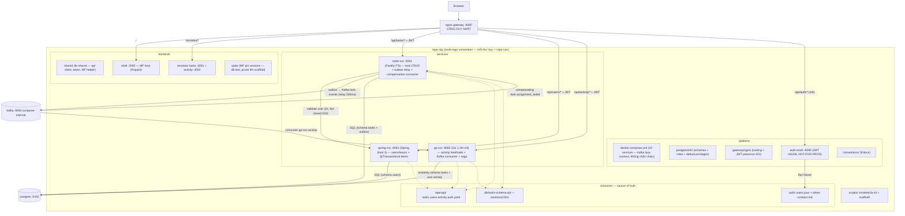

# Boilerplate Microservice + Micro-frontend

Template nội bộ **copy-able**: mixed-stack services (Node/Spring/Go) + Module Federation FE, demo e2e task management qua nginx gateway, Docker Compose + CI. Epic FI-62 — spec: `docs/superpowers/specs/2026-10-12-boilerplate-microservice-mfe.md` (rev 3).

**Người mới bắt đầu:** đọc [docs/walkthrough.md](docs/walkthrough.md) (fresh-clone → demo) + [docs/adr/](docs/adr/) (8 quyết định kiến trúc) + [docs/toolchain.md](docs/toolchain.md) (tool cần ở đâu). Copy thành project mới: `bash scripts/scaffold/scaffold.sh <tên-mới>`.

## Kiến trúc (đã dựng xong — 6 services + 3 FE + gateway + auth-mock + kafka broker)



Chuỗi e2e chứng minh bởi: `scripts/smoke/e2e.sh` (local + CI job `convergence/e2e-smoke`) + browser walkthrough (human gate — [walkthrough.md](docs/walkthrough.md) mục 4).

## Port table

| Thành phần | Port | | Thành phần | Port |
|---|---|---|---|---|
| **nginx gateway** | **8080** | | node-svc | 3001 |
| shell (MF host) | 3000 | | spring-svc | 8081 |
| remote tasks | 4001 | | go-svc | 8082 |
| remote activity | 4002 | | auth-mock | 8090 |
| postgres | 5432 | | kafka (compose-internal) | 9092 — KHÔNG expose host |

Nguồn sự thật: `platform/conventions/05-ports.md`. Đổi port = sửa 4 chỗ cùng commit (conventions + .env.example + compose + README).

## Chạy

### Compose (máy có Docker — CI chạy mode này)

```bash
cd platform
cp .env.example .env        # điền JWT_SECRET (openssl rand -base64 48) + passwords
# Bước 1 — kafka + topics TRƯỚC (kafka KHÔNG có data volume: mỗi compose down
# là mất topics → tạo lại tường minh như CI convergence.yml, tránh 2 race:
# consumer empty-assignment khi subscribe trước topic + DLQ Unknown Topic):
docker compose up -d postgres kafka
until docker compose exec -T kafka /opt/kafka/bin/kafka-broker-api-versions.sh --bootstrap-server localhost:9092 >/dev/null 2>&1; do sleep 2; done
for topic in task-events task-events.dlq; do
  docker compose exec -T kafka /opt/kafka/bin/kafka-topics.sh --bootstrap-server localhost:9092 \
    --create --if-not-exists --topic "$topic" --partitions 1 --replication-factor 1
done
# Bước 2 — phần còn lại của stack (health-gated chain: pg → auth-mock/spring → node → gateway)
docker compose up -d --build
bash ../scripts/smoke/e2e.sh   # PASS = 2 chiều: happy (login→task→feed qua Kafka) + saga (assign svc-fail → assignment_failed → DLQ assert)
# shell + remotes: http://localhost:8080/ → login alice@demo.local / demo-password
# swagger: http://localhost:8080/api/auth/docs (auth-mock; các svc /api/<svc>/docs cần Bearer)
```

> **Kafka lazy-connect** (ADR-0008, conventions/09): kafka compose-internal — 9092
> không expose host, KHÔNG service nào `depends_on` kafka. Services connect retry
> lúc boot (env `KAFKA_BROKERS`) — broker chưa lên không chặn health-gated chain.
> Hợp đồng event: [contracts/events/task-events.md](contracts/events/task-events.md)
> + golden fixtures `contracts/events/fixtures/`. SAGA demo: assign task cho
> `fail@demo.local` → go consumer fail ×3 → task `assignment_failed` + event gốc
> ở `task-events.dlq` (xem [walkthrough.md](docs/walkthrough.md) mục 4b).
> ⚠️ Flyway V2 seed user `svc-fail`/`svc-activity` chạy 1 LẦN lúc volume mới —
> pgdata volume TỪ bản cũ thiếu 2 user này → `docker compose down -v` sau pull.

### Native (không Docker — từng service một)

Xem [docs/walkthrough.md](docs/walkthrough.md) mục 3-đường B (đủ lệnh cho 4 service BE + 3 FE dev servers). Native không có nginx gateway — FE gọi thẳng service port (CORS dev-profile, conventions/07).

### Scaffold project mới

```bash
bash scripts/scaffold/scaffold.sh my-project
cd my-project && pnpm install --no-frozen-lockfile   # lần đầu non-frozen — xem SCAFFOLD.md
```

Copy + rename + prune thuần (không generator) — chi tiết [ADR 0007](docs/adr/0007-fork-not-upgrade.md).

## Repo map

```
contracts/          # source of truth API/DB/auth — spectral lint trong CI
  openapi/          # 4 specs (tasks/users/activity/auth)
  db/               # canonical DDL bảng tasks (node migrate khớp, go query theo)
  auth/             # users fixture + token contract
platform/           # compose (health-gated), postgres init, nginx, auth-mock, conventions/
services/           # node-svc / spring-svc / go-svc — impl hoàn chỉnh, README standalone từng svc
frontend/
  shared/           # fe-shared — api client, token storage, MF bootstrap helper + design system (src/styles tokens+base, src/ui primitives Badge/EmptyState/Skeleton/Spinner)
  shell/            # MF host (Rspack) — login, nav, remote slots
  remotes/          # tasks + activity — 2 MF remote
  spike/            # MF pin versions — đã test (prune khi scaffold)
scripts/
  smoke/e2e.sh      # e2e API-level 2 chiều: happy (login→task→feed qua Kafka) + saga (→ assignment_failed → DLQ)
  scaffold/         # sinh project mới từ boilerplate
.github/
  workflows/        # contracts + per-service + convergence (e2e smoke, copy-dir, scaffold)
  workflow-templates/ # services-ci.yml.example — template cho service mới (prune khi scaffold)
docs/
  adr/              # 8 quyết định kiến trúc
  walkthrough.md    # fresh-clone → demo checklist
  toolchain.md      # tool cần ở đâu (dev/CI/copy-user)
docs/superpowers/   # spec, plans, evidence per SF (prune khi scaffold)
```

## Quy tắc quan trọng (ai copy boilerplate cũng phải biết)

1. API đổi = sửa `contracts/openapi/*.yaml` TRƯỚC (contract-first — [ADR 0003](docs/adr/0003-contract-first.md)), spectral phải pass.
2. JWT: gateway chỉ presence-check; **service tự verify** signature + expiry (`contracts/auth/token-contract.md` §4).
3. auth-mock **NOT FOR PRODUCTION** — copy dự án thật cắm OIDC tại boundary này.
4. Compose health-gated: node/spring probe `/readyz`; go-svc `service_started` (distroless) — readiness chứng minh bằng smoke script (conventions/02 rule 3).
5. fe-shared là dependency chung của shell/remotes — copy FE phải kèm `frontend/shared`.
6. Đổi quyết định kiến trúc = đọc ADR tương ứng trước (mỗi ADR ghi Consequences + điểm cắm thay thế).
