<div align="center">


# microservice_microfrontend_starter

### AI-native full-stack starter for vibe coding — agents clone the repo and get to work.

Rules as **directives** ([AGENTS.md](AGENTS.md)) · contracts **machine-checkable** (spectral + drift-guard) · one-command verify (`pnpm verify:quick`) · generators (`gen:service` / `gen:app` / `gen:feature`) · **N-lane** team workflow with a watchdog.

Everything in the screenshots below is **this repo's real output** — booted with
`docker compose up`. No mocks, no screenshots from other projects.

**117** components · **1,565** tests · **3** npm packages · **11** services

[](https://www.npmjs.com/package/@wakii/ui-kit)
[](https://www.npmjs.com/package/create-wakii-app)
[](https://www.npmjs.com/package/create-wakii-stack)
[](https://storybook-static-khaki-two.vercel.app)
[](LICENSE)

## 🤖 Agents know where everything is

| Agent needs | Open / run | Machine contract |
|---|---|---|
| **Rules** — dos & don'ts | [AGENTS.md](AGENTS.md) → [CLAUDE.md](CLAUDE.md) | if-then directives; branch + commit regex enforced by husky |
| **Knowledge** — traps + task→file map | [docs/ai/knowledge.md](docs/ai/knowledge.md) · [docs/ai/recipes.md](docs/ai/recipes.md) | IF/THEN gotchas; 20 copy-paste recipes |
| **Workflow** — feature → PR | [docs/WORKFLOW.md](docs/WORKFLOW.md) + skill `wakii-ship-feature` | gated lifecycle; 5-line PR checklist |
| **Generators** — scaffold a service / app / feature | `pnpm gen:service` · `gen:app` · `gen:feature` | `--json` → `{created[], modified[], next_steps[]}` — next_steps = AI follow-up directives |
| **Verify** — one command before any PASS | `pnpm verify:quick` | `--json` → `[{step, status, duration}]` + exit code |
| **Team** — N parallel lanes | [docs/team/TEAM.md](docs/team/TEAM.md) · `bash scripts/team/lanes-status.sh` | 1 coordinator with independent gates — N workers, one worktree each |


</div>

---

## Showcase

**What you get** — a task-management platform that actually runs: React Module-Federation UI over
five backend services (Node · Spring · Go · .NET · auth) behind one nginx gateway, Kafka events, a
compensating saga, 1328 green tests — all real output of this repo, booted with `docker compose up`.

| Landing | Kanban | Activity (realtime) |
|:---:|:---:|:---:|
| 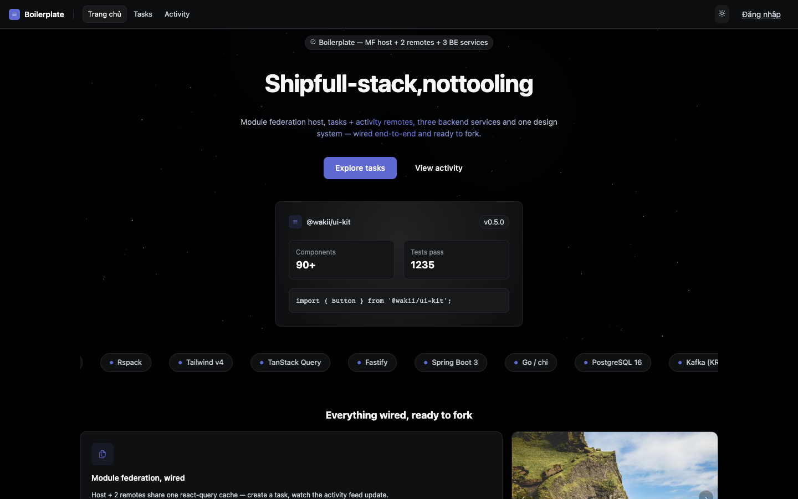 | 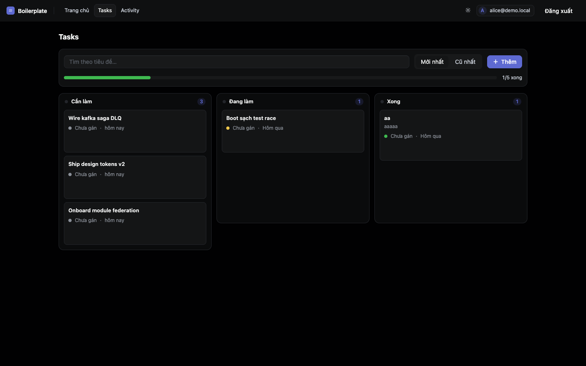 | 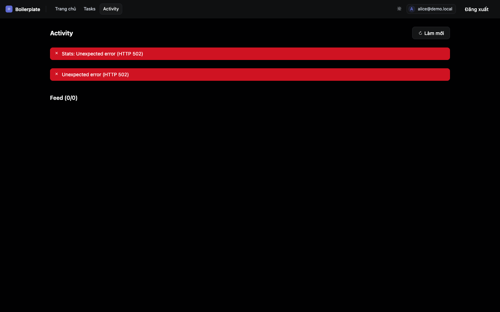 |

**Who is this for** — AI-native vibe coding (agents clone the repo and get to work) and teams
that want a verified full-stack base instead of assembling one from blog posts.

**Try it**

```bash
npm create wakii-app@latest my-app      # ① FE starter
npm create wakii-stack@latest my-stack  # ② full platform — FE + services + gateway + postgres + kafka
```

③ design system alone: `pnpm add @wakii/ui-kit` · live [Storybook](https://storybook-static-khaki-two.vercel.app)

## Real output, not promises


| Kanban — drag a card to change status | Activity — Kafka realtime |
|:---:|:---:|
|  |  |
|  | 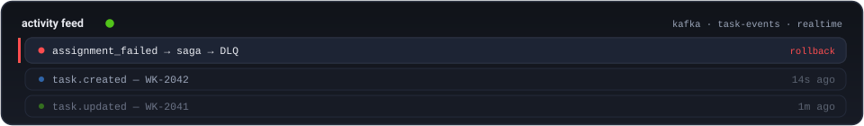 |

Create a task in Kanban → the event flows through **Kafka** → it appears instantly in the Activity feed.
Assign a task to `fail@demo.local` → saga rollback → event lands in the **DLQ**. All of it
is verified by [`scripts/smoke/e2e.sh`](scripts/smoke/e2e.sh) in CI.


## Start in 30 seconds

<div align="center">


</div>

```bash
# ① chỉ FE — React starter (5 preset · 3 framework)
npm create wakii-app@latest my-app                     # demo — showcase ui-kit
npm create wakii-app@latest my-app --preset product    # TanStack Query + zod + MSW
npm create wakii-app@latest my-app --variant next      # hoặc astro

# ② the whole platform — FE + backends + gateway + postgres + kafka
npm create wakii-stack@latest my-stack
cd my-stack && cp platform/.env.example platform/.env
docker compose --env-file platform/.env up -d      # → http://localhost:8080

# ③ the design system alone
pnpm add @wakii/ui-kit        # 117 components, dark/light, motion, a11y
```

> Demo login: `alice@demo.local / demo-password` · Storybook:
> [storybook-static-khaki-two.vercel.app](https://storybook-static-khaki-two.vercel.app)

## Three packages, one ecosystem

| | Package | What it is |
|---|---|---|
| 🎨 | **[@wakii/ui-kit](https://www.npmjs.com/package/@wakii/ui-kit)** | 117 React components (antd × PrimeReact × MUI parity) — tokens-first, Tailwind v4, `UiKitProvider` theming, peer-deps optional sau subpath (`/carousel` `/chart` `/editor` `/schedule` `/experience3d`) |
| ⚡ | **[create-wakii-app](https://www.npmjs.com/package/create-wakii-app)** | CRA-style starter — TS/JS, router v7, demo extras, working dark toggle |
| 🏗️ | **[create-wakii-stack](https://www.npmjs.com/package/create-wakii-stack)** | Full-architecture starter — pick services via manifest, compose/lock/workspace pruned to your selection, `kafka-init` prevents the topic race |

```bash
pnpm add @wakii/ui-kit                   # 🎨 design system
npm create wakii-app@latest my-app       # ⚡ FE starter
npm create wakii-stack@latest my-stack   # 🏗️ full platform
```

<div align="center">


</div>

> All three are also **mirrored on [GitHub Packages](https://github.com/orgs/wakii-dev/packages)** (registry `npm.pkg.github.com`) for org-internal installs. npmjs remains canonical.

## Motion & dark mode built-in

<div align="center">

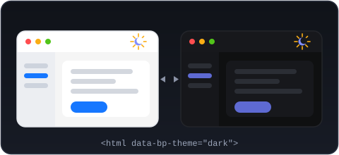

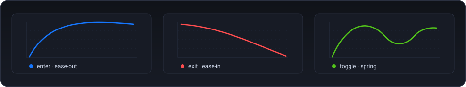

</div>

## What's underneath

<div align="center">


</div>

| Layer | Components |
|---|---|
| **Experience** | shell (landing 3D + nav) · remotes (kanban drag · feed realtime) · admin showcase |
| **Edge** | nginx gateway — routing · JWT presence · `/remotes/*` registry |
| **Services** | node-svc :3001 · spring-svc :8081 · go-svc :8082 · dotnet-svc :8083 · auth-svc :8090 |
| **Infra** | postgres :5432 (schema-per-svc) · kafka :9092 (KRaft + kafka-init) |

## Repo map

```
contracts/    source of truth — openapi (spectral CI) · canonical DDL · token contract
platform/     compose + kafka-init · postgres init · gateway · 9 conventions
services/     node · spring · go · dotnet · auth — each with a standalone README
app/
  ui-kit/     @wakii/ui-kit — components · hooks · tokens · Storybook
  shared/     fe-shared — api client · token storage · MF bootstrap
  shell/      MF host + landing showcase (Scene3D three · tilt card)
  remotes/    tasks (kanban) · activity (feed)
  admin/      showcase SPA — DataTable virtual · zod forms · upload
  create-*/   scaffolders npm + starter-templates + stack-template
docs/         walkthrough · 10 ADRs · toolchain · assets/readme (real screenshots)
scripts/      smoke/e2e.sh · scaffold · snapshot-stack-template
```

## Ground rules

1. **Contract-first** — edit `contracts/openapi/*.yaml` first; spectral must pass ([ADR 0003](docs/adr/0003-contract-first.md))
2. **Gateway chỉ presence-check JWT** — service tự verify signature ([token-contract §4](contracts/auth/token-contract.md))
3. **Kafka lazy-connect + kafka-init** — topics exist before consumers; never `depends_on` the broker ([ADR 0008](docs/adr/))
4. **Changing a port = 4 places in one commit** — conventions/05 · `.env.example` · compose · README
5. **The scaffold ships** `app/shared` (source); `app/ui-kit` installs from npm — `@wakii/ui-kit` latest, no vendored source ([ADR 0010](docs/adr/0010-stack-fe-npm-deps.md))
6. **Changing architecture** — read the ADR first (each ADR records Consequences + swap points)

---

<div align="center">


<sub>

**microservice_microfrontend_starter** — microservice + micro-frontend, tokens all the way down · MIT

[Storybook](https://storybook-static-khaki-two.vercel.app) · [npm](https://www.npmjs.com/~wakii) · [Walkthrough](docs/walkthrough.md) · [ADR](docs/adr/)

</sub>

</div>
