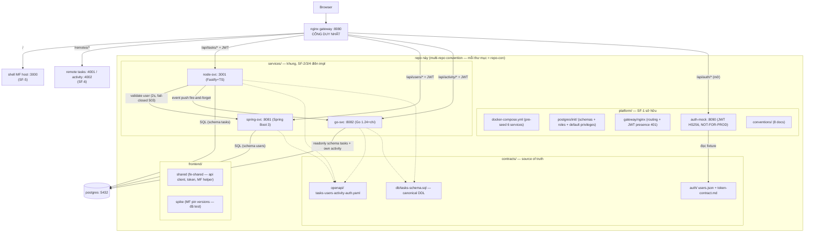

# Boilerplate Microservice + Micro-frontend

Template nội bộ **copy-able**: mixed-stack services (Node/Spring/Go) + Module Federation FE, demo e2e task management qua nginx gateway, Docker Compose + CI. Epic FI-62 — spec: `docs/superpowers/specs/2026-10-12-boilerplate-microservice-mfe.md` (rev 3).

## Kiến trúc



## Port table

| Thành phần | Port | | Thành phần | Port |
|---|---|---|---|---|
| **nginx gateway** | **8080** | | node-svc | 3001 |
| shell (MF host) | 3000 | | spring-svc | 8081 |
| remote tasks | 4001 | | go-svc | 8082 |
| remote activity | 4002 | | auth-mock | 8090 |
| postgres | 5432 | | | |

Nguồn sự thật: `platform/conventions/05-ports.md`. Đổi port = sửa 4 chỗ cùng commit (conventions + .env.example + compose + README).

## Chạy

### Compose (máy có Docker — CI chạy mode này)

```bash
cd platform
cp .env.example .env        # điền JWT_SECRET + các password (placeholder → giá trị thật)
docker compose up -d postgres auth-mock gateway   # SF-1 trio — chạy được ngay
# swagger UI auth-mock QUA GATEWAY: http://localhost:8080/api/auth/docs
# login fixture: alice@demo.local / demo-password (xem contracts/auth/token-contract.md)
docker compose up -d        # sau khi SF-2/3/4 điền impl services
# shell + remotes vào sau SF-5/6 → http://localhost:8080/
```

### Native (dev machine KHÔNG Docker — từng service một)

```bash
# auth-mock (service duy nhất SF-1 chạy được native ngay bây giờ)
cd platform/auth-mock && pnpm install --ignore-workspace
USERS_FIXTURE_PATH=../../contracts/auth/users.json JWT_SECRET=dev-secret-min-32-chars-long!!! CORS_DEV_ORIGIN=http://localhost:3000 pnpm start
# → http://localhost:8090/api/auth/docs

# node-svc / spring-svc / go-svc: sau SF-2/3/4 (mỗi README trong services/<svc>/ có hướng dẫn)
```

> ⚠️ Postgres qua compose/postgres init script là thiết lập chính thức (schemas + per-service roles + readonly grants). Native mode cần Postgres local tự quản — coi `.env.example` là inventory biến.

## Repo map

```
contracts/          # source of truth API/DB/auth — SF-1 sở hữu
  openapi/          # 4 specs — spectral lint trong CI
  db/               # canonical DDL bảng tasks
  auth/             # users fixture + token contract
platform/           # compose, postgres init, nginx, auth-mock, conventions — SF-1 sở hữu
services/           # node-svc / spring-svc / go-svc — khung rỗng, SF-2/3/4 điền
frontend/
  shared/           # fe-shared — SF-1 sở hữu, SF-5/6 READ-ONLY
  spike/            # MF/Rspack spike — pin versions đã test (xoá được sau re-validation)
.github/
  workflows/        # contracts.yml (spectral + gitleaks + compose config + boot-smoke auth-mock + schemathesis)
  workflow-templates/ # services-ci.yml.example — SF-2/3/4 copy + điền
docs/superpowers/   # spec, plans, context packs per SF
```

## Quy tắc quan trọng (ai copy boilerplate cũng phải biết)

1. **SF-2/3/4 KHÔNG sửa** `platform/docker-compose.yml` — chỉ điền impl vào entry có sẵn.
2. **fe-shared READ-ONLY** cho shell/remotes — sửa phải flag coordinator.
3. API đổi = sửa `contracts/openapi/*.yaml` TRƯỚC (contract-first), spectral phải pass.
4. JWT: gateway chỉ presence-check; **service tự verify** signature + expiry (`contracts/auth/token-contract.md` §4).
5. auth-mock **NOT FOR PRODUCTION** — copy dự án thật cắm OIDC tại boundary này.
