# create-wakii-app

<div align="center">



</div>

**5 presets × 3 frameworks. Scaffold → install → run — no cleanup required.**

| Who you are | Command |
|---|---|
| First time with the Wakii kit | `npm create wakii-app@latest my-app` *(demo preset)* |
| Starting a clean product | `… my-app --preset minimal` |
| Real app with an API | `… my-app --preset product` — TanStack Query + zod + MSW + containers/ui/hooks/api |
| Internal tool / dashboard | `… my-app --preset admin` |
| Landing page | `… my-app --preset landing` |
| Next.js / Astro | add `--variant next` / `--variant astro` |

[](https://www.npmjs.com/package/create-wakii-app)
[](./LICENSE)
[](https://nodejs.org)

Scaffold a React app wired with [@wakii/ui-kit](https://www.npmjs.com/package/@wakii/ui-kit) — CRA-style: interactive prompts, non-interactive flags. **Published as [`create-wakii-app@0.1.0`](https://www.npmjs.com/package/create-wakii-app) on npmjs.org.**

## Usage

```bash
npm create wakii-app@latest my-app     # official
npx create-wakii-app my-app            # npx
pnpm create wakii-app my-app           # pnpm
yarn create wakii-app my-app           # yarn
```

Interactive flow — you are only prompted for what's missing (project name → **preset?** → framework vite/next/astro — demo only → react-router? / extras — demo+vite only → confirm → scaffold), then it prints the next steps:

```
cd my-app
pnpm install
pnpm dev
```

## Presets

| Preset | What you get | Base template |
|---|---|---|
| `demo` *(default)* | Kit dogfood demo page + react-router + optional extras (chart/carousel/schedule/editor) — pick the framework via `--variant`: `vite` (SPA, default) / `next` (App Router) / `astro` (React island) | `vite-ts` / `vite-js` / `next-ts` / `astro-ts` |
| `minimal` | Standard architecture (app/routes/shared, lazy router + Suspense, zod env, eslint boundaries, vitest) with a blank page — **no data layer** | `minimal-ts` |
| `product` | minimal + **TanStack Query + zod + MSW** (mock API in dev) + a sample `tasks` feature following the containers pattern + 3 sample tests (api/hooks/ui) | `product-ts` |
| `admin` | product + **admin layout overlay**: collapsible Sidebar + Menu (icon-only when collapsed) + Header, Dashboard page (CountUp KPIs + Table + Timeline), Tasks page, Login page (useForm + zod) | `product-ts` + `template-feats/admin` |
| `landing` | Single-page **motion showcase** (recipes 16-17): Parallax gradient/blob hero + Reveal-staggered KPI statistics + feature cards + FAQ CollapseTransition + closing CTA — **no router, no data layer** | `landing-ts` |

Non-demo presets ship their structure pre-wired (minimal/product/admin include the router; landing is a single page with **no router**), are TS-only, and do not accept `--extras` — conflicts produce a clear error:

```bash
pnpm create wakii-app my-app --yes                                   # demo preset, all defaults
pnpm create wakii-app my-app --variant next --yes                    # demo trên Next.js App Router
pnpm create wakii-app my-app --variant astro                         # demo trên Astro + React island
pnpm create wakii-app my-app --preset minimal --yes                  # blank, no data layer
pnpm create wakii-app my-app --preset product --yes                  # + TanStack Query/zod/MSW
pnpm create wakii-app my-app --preset admin --yes                    # + admin layout (dashboard + login)
pnpm create wakii-app landing-app --preset landing --yes             # single-page motion landing
pnpm create wakii-app ~/code/my-app --lang js --skip-install         # path + JavaScript (demo preset only)
```

## Flags

| Flag | Meaning | Default |
|---|---|---|
| `[appName]` (positional) | A name **or a path**: `my-app` → `./my-app`; `/a/b/my-app` → target `/a/b/my-app`. The package name is always the **basename** (a path never leaks into package.json) | prompt (`my-wakii-app`) |
| `--preset <name>` | `demo \| minimal \| product \| admin \| landing` (also accepts `--preset=product`) | `demo` |
| `--variant <name>` | `vite \| next \| astro` — framework for the **demo preset** (also accepts `--variant=next`). Demo only: other presets → "variant is demo-only" error | `vite` |
| `--lang ts\|js` | TypeScript / JavaScript (also accepts `--lang=js`). Non-demo presets are TS-only (clear error otherwise) | `ts` |
| `--router` / `--no-router` | react-router v7 — a **demo × vite** choice (prompted when missing — unless `--yes`); non-demo templates manage their own routing (landing: single page, no router) | on |
| `--extras <list>` | demo subpaths: `chart · carousel · schedule · editor` (also accepts `--extras=a`). Extras **imply the router** (each demo subpath is its own route). Non-demo presets → "extras are demo-only" error | none |
| `--yes` | skip prompts, take all defaults | — |
| `--skip-install` | omit `pnpm install` from the next steps | — |
| `-h`, `--help` | print usage | — |

Intentional errors: `--no-router` together with `--extras` (demo), a non-demo preset with `--extras`/`--lang js`, `--variant` ≠ `vite` on a non-demo preset or with `--lang js`/`--extras` — the CLI reports each conflict clearly and exits (drop one of the two). The CLI **never installs** anything — it only prints next steps (`cd` to the exact target it created, even when you passed a path).

## What's in the template

Base (ts/js) — a demo app dogfooding **`@wakii/ui-kit`** (pinned to the latest release with dist exports):

- **A working dark toggle** — `useAppTheme` (src/theme) persists to `localStorage` and sets `data-bp-theme` on `<html>`; every kit component cascades, no re-render.
- **Demo components**: hero + Tag/Title/Text + 3 Buttons · a 3-column Table (badge statuses) · Alert ×4 · CountUp statistics · a "What's inside" Card (Storybook + npm links).
- **Tokens-first**: a single styles.css (kit tokens + base + Tailwind v4 + the kit `@source`) — zero hex in the app.

Router (on by default, react-router v7): a `/` demo route plus `/about` introducing the kit (NavLink). Extras: each extra adds one demo route using the matching subpath (`@wakii/ui-kit/chart`, `./carousel`, `./schedule`, `./editor`) and writes its peer dependency into package.json.

## Architecture (repo)

- `src/options.ts` — hand-rolled flag parser (zero parser dependencies) + defaults + validation (`--no-router` × `--extras`, non-demo × `--extras`/`--lang js`, variant ≠ vite × non-demo/extras/js throw)
- `src/scaffold.ts` — maps preset → base template (`demo` → `vite-ts|vite-js` per `--variant`, or `next-ts`/`astro-ts`; `minimal` → `minimal-ts`, `product` → `product-ts`, `admin` → `product-ts` **+ `template-feats/admin` overlay on top**, `landing` → `landing-ts`) → recursive copy → renders the `{{appName}}` placeholder (binaries skipped) → applies overlays → merges dependencies into package.json (router dep only for `demo` — the other templates list their own deps)
- `src/index.ts` — the `@clack/prompts` flow + logging + next steps (UI wiring only; preset is asked first, variant prompt is demo-only, router/extras prompts are demo × vite only)

Template sources: `app/starter-templates/{vite-ts,vite-js,minimal-ts,product-ts,next-ts,astro-ts,landing-ts}` + `template-feats/{router,extras,admin}` (owned by separate workers). JS-variant overlays must be type-free (the engine only renames `.tsx→.jsx`); if an overlay ships its own `vite-js/` directory, that directory is used as-is. Non-demo presets are TS-only.

## Development

```bash
pnpm --filter create-wakii-app typecheck
pnpm --filter create-wakii-app test      # fixture templates in tmp — no network
```

Publishing to npmjs: `./scripts/publish-npm.sh` — builds (tsup), then bundles `dist` + **`starter-templates/`** (the whole directory: vite-ts, vite-js, minimal-ts, product-ts, next-ts, astro-ts, landing-ts + template-feats) into the package (`files` field — npm rejects parent paths like `../`), sets `publishConfig` to public, and publishes using `NPM_TOKEN` (env) or an existing `_authToken` in `~/.npmrc`.

## CI

Golden-path workflow [`.github/workflows/starter-templates.yml`](../../.github/workflows/starter-templates.yml) — runs on every push/PR touching `app/create-wakii-app/**` or `app/starter-templates/**`: CLI test + typecheck → tsup build → scaffolds all 7 flavors (`demo-ts` · `demo-js` · `next` · `astro` · `minimal` · `product` · `admin`) into `/tmp` → each app must `pnpm install` + `pnpm build` (plus `pnpm test` for `product`/`admin`). Any failing step turns the job red — a pre-publish guard against a repeat of the 0.5.0/0.6.x incidents (templates published while scaffolded apps failed to build). Note: repo Actions are currently disabled (billing) — the workflow will run once enabled.

## License

MIT — see [LICENSE](./LICENSE).
