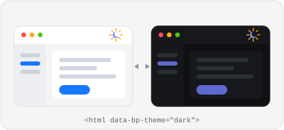
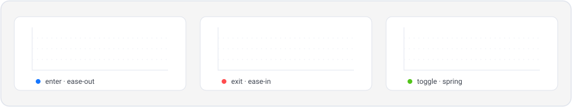

<div align="center">

# 🎨 @wakii/ui-kit

<p align="center">
  
</p>

**A production-grade React design system built AI-first — 90+ components, 31 hooks, tokens-first, motion, dark theme.**

Benchmarked against Ant Design & PrimeReact. Ships with `AGENTS.md` + recipes so AI agents build real features correctly on day one.

[](https://www.npmjs.com/package/@wakii/ui-kit)
[](./LICENSE)
[](https://storybook-static-khaki-two.vercel.app)

## 🤖 Built for AI agents — not just humans

This library is **AI-consumable by design**. Every agent (Claude Code, Codex, ZCode, Cursor…) that opens this repo gets productive immediately:

| Mechanism | What it does for AI |
|---|---|
| **[`AGENTS.md`](../../AGENTS.md)** (repo root) | Auto-read by agent CLIs on session start — feature→component map, mandatory rules, anti-patterns. Zero onboarding cost. |
| **[`docs/ai/recipes.md`](../../docs/ai/recipes.md)** | 10 copy-paste recipes for real features: CRUD pages, login flows, wizards, upload pipelines, dashboards. Agent picks a recipe, renames fields, ships. |
| **Behavior tests (1290)** | Every component tested by *what it does* (clicks→callbacks, state classes, keyboard flows) — agents verify their work against the same assertions. |
| **Tokens-first + z-scale + size scale** | Hard constraints instead of conventions: one source of truth CSS vars, `--z-*` layers, `h-8/9/10`. Machine-checkable, no aesthetic guessing. |
| **Living Storybook (683 stories, [live](https://storybook-static-khaki-two.vercel.app))** | Every state of every component rendered — ground truth for visual verification loops. |
| **Strict single-button rule & friends** | Sharp opinions (no dividers on split buttons, focus-ring standard) so agents converge on ONE correct output, not five variants. |

**Dogfooded by the multi-agent workflow itself**: this library was audited, restyled and completed by *5 coordinated AI terminals in parallel* (coordinator + workers pattern), gated by pixel-level automated verification. The AI-facing docs, checklists and recipes in this repo are the same ones those agents used.

> Practical loop that works today: agent reads `AGENTS.md` → picks recipe → implements → runs `vitest` (1290 tests catch wiring mistakes) → checks Storybook for visual truth → done.

[](#-quality)
[](#)

[📖 Live Storybook](https://storybook-static-khaki-two.vercel.app) ·
[📦 npm](https://www.npmjs.com/package/@wakii/ui-kit) ·
[🏠 GitHub](https://github.com/wakii-dev/architecture-overview) ·
[📚 Full docs](./USAGE.md)

</div>

---

## ✨ Why @wakii/ui-kit

| | |
|---|---|
| 🧩 **90+ components** | From DataTable with **virtual scroll (5k+ rows)** to Upload Dropzone, TreeSelect, TimePicker, range DatePicker — the parts real apps actually need |
| 🪝 **31 battle-tested hooks** | `useForm` (zod-powered), `useDebounce`, `useClickAway`, `useInView`, `useScrollProgress`, `useControllableState`… every hook ships behavior tests |
| 🌗 **Dark theme, done right** | One attribute — `<html data-bp-theme="dark">`. CSS-variable cascade, no flash, no JS, no rebuild — dark tokens polished mirror-antd (alert tints, disabled, shadows), Storybook manager chrome ships both palettes |
| 🎯 **Tokens-first** | One `tokens.css` is the single source of truth — colors, spacing, radii, shadows, even a **z-index scale**. No hardcoded hex in components |
| 🚀 **Motion with taste** | Scroll-linked & mount primitives — `Reveal`, `Parallax`, `CountUp`, `Transition` family (Fade/Zoom/Collapse), `ScrollPage` — zero animation deps, respects `prefers-reduced-motion` |
| ♿ **Real a11y** | Focus trap + focus restore in Modal/Drawer, ARIA roles, full keyboard support — verified in Storybook |
| 🪶 **Smart weight** | Heavy engines (Swiper, Chart.js, Tiptap, FullCalendar) are optional peers behind subpath exports — your bundle stays lean |
| 🧪 **1290 behavior tests** | We test clicks → callbacks, state classes, keyboard flows. Not smoke renders |

<p align="center">
  
</p>

## 🚀 Quick start

```bash
npm install @wakii/ui-kit
```

<p align="center">
  
</p>

```tsx
// one CSS file — tokens + utilities + motion, all compiled
import '@wakii/ui-kit/styles/ui-kit.css';

import { Button } from '@wakii/ui-kit';

export function App() {
  return <Button variant="primary" icon="check">Get started</Button>;
}
```

### 🌗 Dark mode in one line

```html
<html data-bp-theme="dark">
```

<p align="center">
  
</p>

### 📝 Forms with zod — schema is the single source of truth

```tsx
import { z } from 'zod';
import { useForm, Field, Input } from '@wakii/ui-kit';

const schema = z.object({
  email: z.string().email('Invalid email'),
});

const form = useForm({ schema, mode: 'onBlur' });

<Field label="Email" error={form.errors.email} required>
  <Input
    value={form.values.email}
    invalid={!!form.errors.email}
    onChange={form.handleChange('email')}
    onBlur={form.handleBlur('email')}
  />
</Field>
```

## 🆕 What's new in 0.4.0

- **Hooks wave — barrel mở trọn**: 12 lifecycle/scroll hooks (`useScrollProgress`, `useInView`, `useInfiniteScroll`, `useControllableState`, `useMeasure`…) + **utils** (`formatCurrency`, `formatRelativeTime`, `chunk`, `groupBy`, `flattenTree`, `getScrollParent`, `cx`…) + `ScrollPage` section-snap — table grouped below.
- **Dark theme, toàn diện**: dark tokens polish mirror-antd (alert alpha tints, disabled surface, heavier shadows) + `color-scheme` per-theme — Storybook **manager chrome ships both palettes**.
- **Motion showcases**: `Landing` + `Parallax Landing` (depth-trio hero, parallax lab) + `Cinematic Experience` (glass-nav chaptershell) templates.
- **Team-OS domain pack**: `PingFeed`, `StagePipeline`, `DebtBoard`, `TeamDashboard`, `InboxThread`.
- **Chart dark-live**: `useChartColors` probe + `data-bp-theme` observer — charts re-resolve colors on theme toggle, no reload.
- **Icon set 52** (`filter-fill` / `filter-slash` mới) — glyph characters swept to SVG everywhere. Full detail: [CHANGELOG.md](./CHANGELOG.md).

## 🧩 Component map

<p align="center">
  
</p>

| Group | Components |
|---|---|
| **Layout & Navigation** | Sidebar (collapsible 200→80px) · Menu / nested Submenu · Breadcrumb · Steps · Tabs · Pagination (antd look) · TabMenu · Menubar · Dropdown · SpeedDial |
| **Data display** | DataTable (filters, selection kept across pages, **virtual scroll**) · List · Tree · TreeSelect · Descriptions · Timeline · Statistic · Avatar · AvatarGroup · Badge · Tag · Collapse · Card · Image · Galleria · Carousel (Swiper) · Chart · Calendar · DatePicker (range + time + vi/en locale) · TimePicker · Schedule |
| **Forms** | Input · Textarea · InputNumber · InputMask · InputOTP · Select · AutoComplete · CascadeSelect · Checkbox · Radio · Switch · Slider · Rate · ColorPicker · Upload + UploadDropzone (drag & drop) · Field wrapper · Editor (Tiptap) |
| **Feedback** | Alert (filled by default + outlined) · Message · Notification · Modal · Drawer · Popconfirm · Progress · Skeleton · Spinner · Result · EmptyState · BlockUI |
| **Overlay** | Tooltip · Popover · ContextMenu — all on the tokenized `--z-*` scale |
| **Motion & scroll** | `Reveal` (IntersectionObserver stagger) · `Parallax` (scroll-linked) · `CountUp` · `Transition` family (Fade / Zoom / CollapseTransition) · `Backdrop` · `ScrollPage` (section snap) |
| **Team-OS domain** | `PingFeed` · `StagePipeline` · `DebtBoard` · `TeamDashboard` · `InboxThread` |
| **Utils** | `formatCurrency` / `formatBytes` / `formatRelativeTime` / `formatNumber` · `chunk` / `groupBy` / `flattenTree` / `findTreeNode` · `getScrollParent` / `getFocusableElements` / `cx` |
| **Icons** | `Icon` component — 52 primeicons-derived SVG paths, tree-shakeable |

<details>
<summary><b>31 Hooks — grouped</b></summary>

| Group | Hooks |
|---|---|
| **Forms** | `useForm` (zod) · `useFieldArray` · `useFocusTrap` |
| **State** | `useLocalStorage` · `useSessionStorage` · `useToggle` · `usePrevious` · `useDefault` · `useControllableState` |
| **Time** | `useDebounce` · `useThrottle` · `useTimeout` · `useCountdown` |
| **DOM & viewport** | `useHover` · `useKeyPress` · `useClickAway` · `useMediaQuery` · `useWindowSize` · `useLockBodyScroll` · `useCopyToClipboard` · `useEventListener` · `useMeasure` · `useFullscreen` |
| **Scroll & lifecycle** | `useScrollProgress` · `useInView` · `useInfiniteScroll` · `useOnlineStatus` · `useTitle` · `useMountEffect` · `useUpdateEffect` · `useIsFirstRender` |

</details>

## 🧩 Templates — full pages composed from the kit

Mỗi template là **1 story sống** trong Storybook — controlled state thật (drag card, filter,
log giờ đều chạy), không phải mock render. Copy về app, đổi data là dùng.

| Template | Components chính | Story path (`?path=/story/…` trên :6006 hoặc live Storybook) |
|---|---|---|
| **Dashboard** (admin) | `Layout` (Sider+Header) · `Row/Col` · `Card`/`Statistic` · `Table` · `Timeline` · `Chart` | `templates-dashboard--dashboard` |
| **Kanban Project** | `KanbanBoard` (4 cột + WIP limit) · `Segmented`/`Input.Search`/`Select` filter · `Avatar`/`Badge`/`Tag` · `Timesheet` · `message` | `templates-kanban-project--project-board` |
| **CRUD Table** | `Table` (sort/filter/pagination/expandable/loading) · `Modal` form · `message` | `templates-crud-table--full-demo` |
| **Auth** (Sign in / Sign up / split) | `useForm` + `zod` · `Field`/`Input`/`Button`/`Checkbox` · `Layout` split | `templates-auth--sign-in` · `--sign-up` · `--split-layout` |
| **Settings** | `Tabs`/`Segmented` · `Switch`/`Checkbox` · `ColorPicker` (accent live qua `UiKitProvider`) · dark preview | `templates-settings--settings` |
| **Landing** | `Button` · `Tag` · `Typography` · `Divider` + motion hero | `templates-landing--landing-alive` · `--landing-minimal` |
| **Parallax Landing** | `Parallax` · `Reveal` · `CountUp`/`Statistic` — depth-trio hero + parallax lab | `templates-parallax-landing--landing` · `--hero-depth` · `--parallax-lab-only` |
| **Cinematic Experience** | `ChapterShell` glass-nav chapters + hero variants | `templates-cinematic-experience--experience` · `--hero-only` · `--atlas` · `--dark-snow` |

> Trạng thái thật (0.4.0): **8 templates live** — Dashboard, Kanban Project, CRUD Table,
> Auth, Settings, Landing, Parallax Landing, Cinematic Experience (kèm demo Team-OS
> components trong story riêng). Recipes copy-chạy: [recipes.md](../../docs/ai/recipes.md).

<p align="center">
  
</p>

## 🔬 Quality

- **1290 behavior tests / 163 test files** (clicks → callbacks, state classes, keyboard flows)
- **Storybook test-runner**: stories render-verified on every push
- Dark-mode audited across every component (light antd default + dark direction-B)
- `prefers-reduced-motion` respected globally

## 📚 Documentation

- [USAGE.md](./USAGE.md) — deep dives per group (forms, icons, subpaths, z-index)
- [CHANGELOG.md](./CHANGELOG.md) / [MIGRATION.md](./MIGRATION.md) — releases & breaking changes (Alert filled, antd Pagination, subpath heavy engines)
- [parity-matrix.md](../docs/parity-matrix.md) — component-by-component benchmark vs antd/PrimeReact

<div align="center">

**MIT** © [wakii-dev](https://github.com/wakii-dev) — built with 🤖 multi-agent pair-coding

</div>
